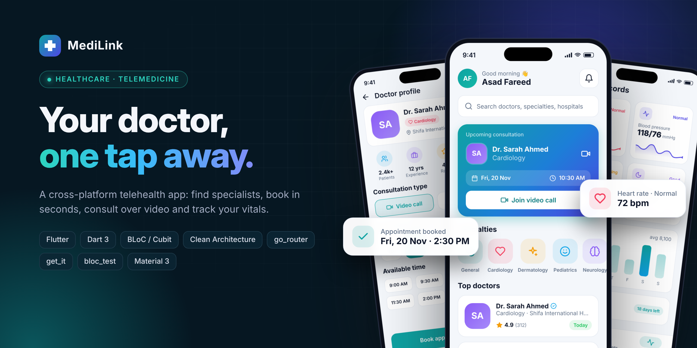
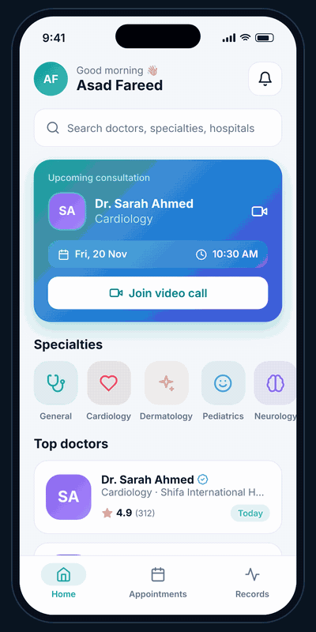
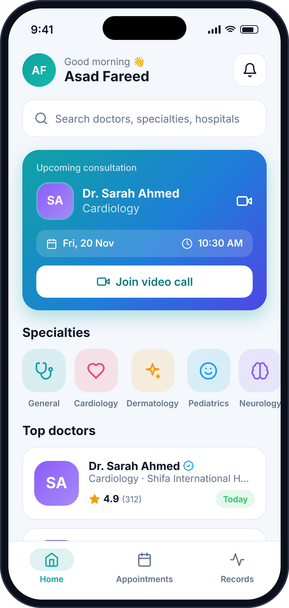
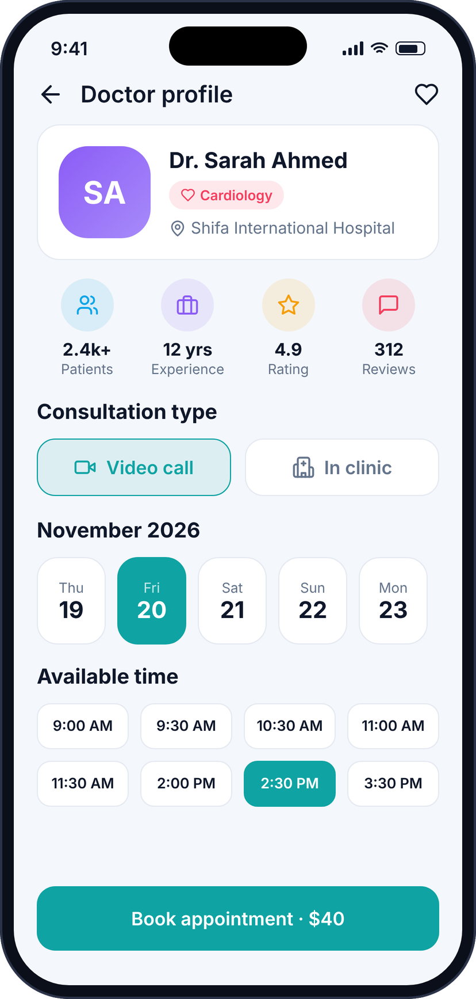
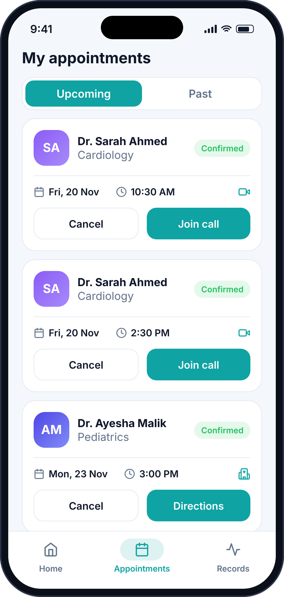
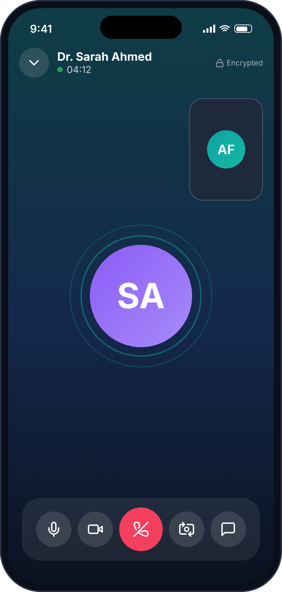
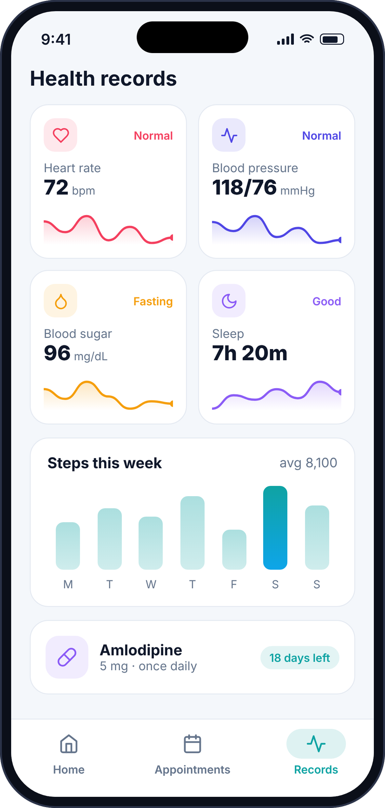

<p align="center">
  
</p>

<h1 align="center">MediLink: Telemedicine App in Flutter</h1>

<p align="center">
  
  
  
  
  
</p>

<p align="center">
  <a href="https://github.com/asadfareed777/medilink-telehealth/releases/latest">
    
  </a>
  &nbsp;
  <a href="https://github.com/asadfareed777/medilink-telehealth/actions/workflows/flutter.yml">
    
  </a>
</p>

MediLink is a cross-platform telehealth app. Patients can find specialists, book consultation slots, join video consultations and track their vitals. It's built with Flutter on a feature-first Clean Architecture with BLoC state management and tests at the bloc and widget level.

## Demo

<p align="center"></p>

## Screens

| Home | Doctor & booking | Appointments | Video consultation | Health records |
|:---:|:---:|:---:|:---:|:---:|
|  |  |  |  |  |

## Features

- **Doctor discovery:** search by name, specialty or hospital, filter by specialty chips, and see results sorted by rating with "available today" badges.
- **Smart booking:** a 7-day date strip and time slots generated per doctor. Lunch breaks, past times and already-booked slots are excluded, and double-booking is detected and handled gracefully.
- **Appointments:** upcoming and past tabs with live updates through a repository `Stream`, plus cancel, join call and directions actions.
- **Video consultation:** connecting and live states with a running timer, mic and camera toggles, camera flip and hang-up, driven by a `CallCubit` that is ready to wrap a WebRTC SDK (Agora, Twilio or flutter_webrtc).
- **Health records:** vitals cards with `CustomPainter` sparklines, an animated weekly steps chart and a prescriptions list.

## Architecture

```
lib/
├── core/                 # theme, DI (get_it), router (go_router), clock, shared widgets
└── features/
    ├── doctors/          # domain · data · presentation (DoctorsBloc)
    ├── appointments/     # domain · data · presentation (BookingCubit, AppointmentsCubit)
    ├── consultation/     # CallCubit + call UI
    └── records/          # RecordsCubit + vitals UI
```

- **Feature-first Clean Architecture.** Each feature has `domain` (entities and repository contracts), `data` (implementations) and `presentation` (BLoC/Cubit and widgets). The UI only ever talks to blocs, and blocs only talk to repository interfaces.
- **BLoC for event-driven flows** (doctor search and filters) and **Cubit for simpler state machines** (booking, call, records). All states are immutable `Equatable` classes.
- **An injectable `Clock`** makes the time-based booking rules deterministic in tests.
- **go_router** uses a `StatefulShellRoute` for the bottom navigation (each tab keeps its own stack), with full-screen routes for the doctor profile and the call.

## Tech stack

| Concern | Choice |
|---|---|
| UI | Flutter, Material 3, custom painters, implicit animations |
| State | flutter_bloc (Bloc + Cubit), equatable |
| Navigation | go_router (StatefulShellRoute) |
| DI | get_it |
| Testing | flutter_test, bloc_test, mocktail |
| CI | GitHub Actions: analyze, test, build release APK |

## Getting started

```bash
git clone https://github.com/asadfareed777/medilink-telehealth.git
cd medilink-telehealth
flutter create --platforms=android,ios --org com.asadfareed .   # generates platform folders (first time only)
flutter pub get
flutter run
```

## Tests

```bash
flutter test
```

- `doctors_bloc_test.dart`: loading and failure states, specialty toggle, search, rating sort
- `booking_cubit_test.dart`: 7-day window, past and lunch slots excluded, booking, double-booking recovery
- `appointments_cubit_test.dart`: upcoming/past split, cancellation flow, call timer and controls
- `widget_test.dart`: app boots to the home screen with doctors and navigation

## Roadmap

- Real-time video with WebRTC (Agora / flutter_webrtc)
- Firebase Auth and Firestore backend
- In-call chat and file sharing (lab reports)
- Push reminders before appointments

## License

MIT. See [LICENSE](LICENSE).

---

<p align="center">Built by <a href="https://github.com/asadfareed777"><b>Asad Fareed</b></a>, Senior Flutter & Android Engineer</p>
